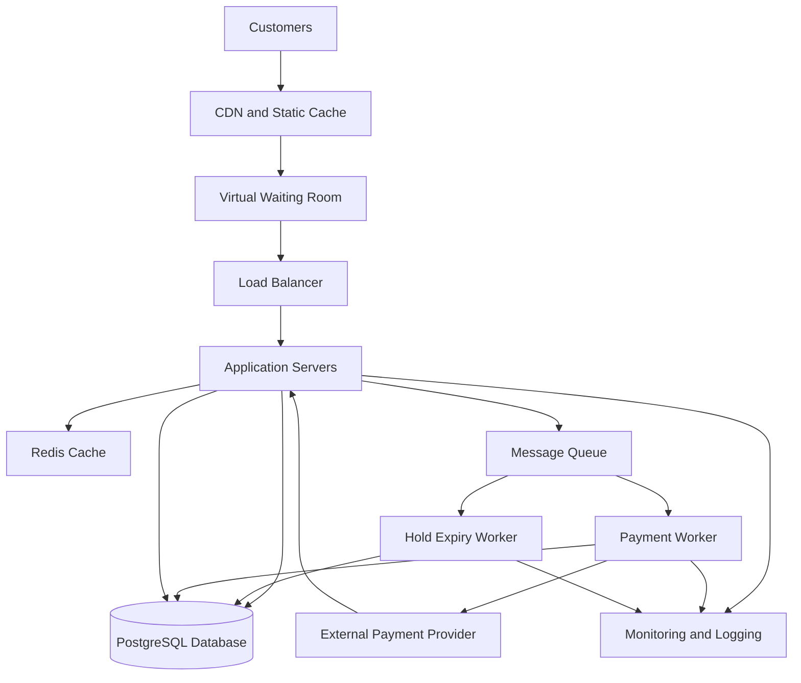

# TicketHub: Event Ticketing System Design

## 1. Requirements

### 1.1 Functional Requirements

TicketHub is a website that allows users to discover events, select seats, purchase tickets and view their orders.

The system must:

1. Allow users to register, log in and manage their accounts.
2. Display upcoming concerts and events, including dates, venues, prices and available seats.
3. Allow users to view a seating plan and check seat availability.
4. Allow users to temporarily hold available seats while completing a purchase.
5. Allow users to pay for held seats and receive confirmed tickets.
6. Release seats automatically when a hold expires or a payment fails.
7. Allow users to view their orders and purchased tickets.
8. Prevent two customers from purchasing the same seat for the same event.
9. Provide administrators with tools to create events, configure seating and monitor sales.

### 1.2 Non-Functional Requirements

**Performance:** Event listings and seat availability should normally load within two seconds under ordinary traffic. During major sales, the system should remain responsive and communicate queue positions or waiting status to customers.

**Correctness and consistency:** A seat must never be sold to more than one customer. The database must enforce seat availability and order consistency, even when concurrent requests attempt to reserve the same seat.

**Fairness:** During a high-demand sale, a virtual waiting room should manage incoming customers using a transparent queue policy, such as first-in, first-out within the applicable sale rules. Customers must not gain priority simply by repeatedly refreshing or sending more requests.

**Availability:** The website should continue serving browsing requests during heavy demand. If the payment provider or a critical service becomes unavailable, the system should fail safely rather than confirm an unverified payment.

**Scalability:** The system should scale its web servers and supporting services horizontally to handle increases in visitors and purchase requests.

**Security:** Passwords must be securely hashed. The system must use HTTPS, validate input, enforce access controls, protect payment operations against replay, and avoid storing raw payment-card details.

**Reliability:** Orders and payment operations must be recoverable after failures. Payment callbacks must be processed idempotently so that repeated notifications do not create duplicate orders or charges.

**Maintainability:** The system should use clearly separated components, automated tests, monitoring and documented APIs to simplify troubleshooting and future development.

## 2. Traffic Estimates

### 2.1 Normal Traffic

TicketHub has 2 million registered users. On a normal day, 50,000 people visit the website, and each visitor views 10 pages.

- Daily visitors: 50,000
- Page views per visitor: 10
- Total daily page views: 50,000 × 10 = 500,000
- Average page views per second: 500,000 ÷ 86,400 ≈ 5.8
- Tickets sold daily: 5,000
- Average ticket sales per second: 5,000 ÷ 86,400 ≈ 0.058

These are daily averages, not peak rates. Actual traffic will vary by time of day, and page views are not the same as API requests because one page may generate several requests.

### 2.2 Major Concert Sale

During a popular concert sale, 200,000 people attempt to buy 20,000 seats within the first 10 minutes.

- People attempting to buy: 200,000
- Seats available: 20,000
- Sale duration: 10 minutes = 600 seconds
- Average incoming purchase attempts per second: 200,000 ÷ 600 ≈ 333
- Maximum proportion of customers who can obtain a seat: 20,000 ÷ 200,000 × 100 = 10%

If all 200,000 people request a seat view during the same 10-minute period, that alone represents approximately 333 seat-view requests per second. Additional page loads, polling, retries and payment requests will increase total traffic.

The 333 requests per second figure is an average for the stated period, not a guaranteed peak. Real demand may arrive in bursts, so capacity planning must account for higher short-term rates.

### 2.3 Comparison

Normal traffic averages approximately 5.8 page views per second across the full day. The major sale may generate approximately 333 purchase attempts per second, about 57 times the normal average page-view rate.

This comparison is useful but not perfectly like-for-like: page views and purchase attempts are different types of requests. The major sale also creates much greater pressure on the database because many customers may compete for a limited set of seats.

TicketHub should therefore use a virtual waiting room, caching for event information, rate limiting, scalable application servers and strict database controls for seat reservations.

## 3. API Design

TicketHub will provide a REST API that allows the website to communicate with the backend. The API will use JSON for request and response bodies and HTTPS for secure communication. Authenticated endpoints will require a valid user session or access token.

| Method | Endpoint                       | Purpose                                                           |
| ------ | ------------------------------ | ----------------------------------------------------------------- |
| GET    | /api/events                    | List upcoming events, with pagination and optional search filters |
| GET    | /api/events/{eventId}          | Retrieve details of a specific event                              |
| GET    | /api/events/{eventId}/seats    | Display seats and their current availability                      |
| POST   | /api/events/{eventId}/holds    | Temporarily reserve available seats for the authenticated user    |
| POST   | /api/orders/{orderId}/payments | Initiate payment for a held-seat order                            |
| GET    | /api/tickets                   | Retrieve tickets belonging to the authenticated user              |
| GET    | /api/orders/{orderId}          | View the status and details of an order                           |

### 3.1 Browsing Events

The event-listing endpoint returns event names, dates, venues, prices and identifiers. Pagination limits the number of records returned per request. Frequently requested event information can be cached to reduce database load.

### 3.2 Viewing Seats

The seat-view endpoint returns seat identifiers, row and section information, prices and availability states. Seat availability can change between viewing the seating plan and selecting a seat. Therefore, the displayed status is informational; the database must verify availability again when a customer requests a hold.

### 3.3 Holding Seats

A customer submits a POST request containing the selected seat identifiers. The backend verifies that the seats belong to the specified event and are available. It then creates a temporary hold with an expiry time, such as five minutes.

The operation must be atomic: either all requested seats are held successfully or none are held. If any selected seat is unavailable, the request should fail with an appropriate conflict response, such as HTTP 409.

The hold endpoint should support an idempotency key so that a retried request does not accidentally create a second hold or order.

### 3.4 Paying for an Order

The payment endpoint initiates payment for an order associated with a valid seat hold. The server verifies the order, hold expiry and payment status before contacting the payment provider.

A verified payment-provider response or authenticated callback updates the order and confirms the tickets. Repeated callbacks must not process the same payment more than once. If payment remains pending, the system must not prematurely mark the tickets as paid.

The system must define a consistent policy for holds expiring during payment processing. A seat must not be released and resold while a payment is being accepted for the same reservation.

### 3.5 Viewing Tickets

The ticket endpoint returns only tickets belonging to the authenticated user. Each confirmed ticket has a unique ticket identifier linked to its order and event. The backend must verify ownership before returning ticket details.

### 3.6 API Security and Error Handling

The API will use authentication, authorization, input validation, rate limiting and structured error responses. Public browsing endpoints may permit unauthenticated access, but holding seats, paying and viewing personal tickets require authentication.

The system should return appropriate HTTP status codes, including 200 for successful retrieval, 201 for successful creation, 401 for unauthenticated requests, 403 for unauthorized access, 404 for missing resources, 409 for seat conflicts and 429 when rate limits are exceeded.

## 4. Data Model

TicketHub will use a relational database such as PostgreSQL because transactions, unique constraints and foreign keys are important for reliable ticket sales.

The core model contains six tables: users, events, seats, seat_holds, orders and tickets.

### 4.1 Users Table

| Column        | Type                | Description              |
| ------------- | ------------------- | ------------------------ |
| user_id       | BIGINT PRIMARY KEY  | Unique user identifier   |
| name          | VARCHAR(150)        | User's display name      |
| email         | VARCHAR(255) UNIQUE | Unique account email     |
| password_hash | TEXT                | Securely hashed password |
| created_at    | TIMESTAMP           | Account creation time    |

### 4.2 Events Table

| Column     | Type               | Description                            |
| ---------- | ------------------ | -------------------------------------- |
| event_id   | BIGINT PRIMARY KEY | Unique event identifier                |
| title      | VARCHAR(200)       | Event name                             |
| venue      | VARCHAR(200)       | Event venue                            |
| event_date | TIMESTAMP          | Event date and time                    |
| status     | VARCHAR(30)        | Draft, scheduled, on sale or cancelled |
| created_at | TIMESTAMP          | Record creation time                   |

### 4.3 Seats Table

| Column      | Type               | Description                    |
| ----------- | ------------------ | ------------------------------ |
| seat_id     | BIGINT PRIMARY KEY | Unique seat identifier         |
| event_id    | BIGINT FOREIGN KEY | References events(event_id)    |
| section     | VARCHAR(50)        | Seating section                |
| row_label   | VARCHAR(20)        | Row identifier                 |
| seat_number | VARCHAR(20)        | Seat identifier within the row |
| price       | DECIMAL(10,2)      | Ticket price                   |
| status      | VARCHAR(20)        | Available, held or sold        |

A UNIQUE constraint on (event_id, section, row_label, seat_number) prevents duplicate definitions of the same physical seat for an event.

### 4.4 Seat Holds Table

| Column     | Type               | Description                             |
| ---------- | ------------------ | --------------------------------------- |
| hold_id    | BIGINT PRIMARY KEY | Unique hold identifier                  |
| seat_id    | BIGINT FOREIGN KEY | References seats(seat_id)               |
| user_id    | BIGINT FOREIGN KEY | References users(user_id)               |
| expires_at | TIMESTAMP          | Time when the hold expires              |
| status     | VARCHAR(20)        | Active, converted, expired or cancelled |
| created_at | TIMESTAMP          | Hold creation time                      |

A seat can have a history of expired or cancelled holds. However, the database must prevent more than one active hold from controlling the same seat at the same time.

### 4.5 Orders Table

| Column            | Type                | Description                                            |
| ----------------- | ------------------- | ------------------------------------------------------ |
| order_id          | BIGINT PRIMARY KEY  | Unique order identifier                                |
| user_id           | BIGINT FOREIGN KEY  | References users(user_id)                              |
| status            | VARCHAR(30)         | Pending, payment pending, confirmed, failed or expired |
| total_amount      | DECIMAL(10,2)       | Total order amount                                     |
| idempotency_key   | VARCHAR(255) UNIQUE | Prevents duplicate order creation on retries           |
| payment_reference | VARCHAR(255) UNIQUE | Unique payment-provider reference                      |
| created_at        | TIMESTAMP           | Order creation time                                    |

The order records the customer and the overall purchase status. A production implementation may also use a separate payments table to retain payment attempts and their outcomes.

### 4.6 Tickets Table

| Column    | Type               | Description                  |
| --------- | ------------------ | ---------------------------- |
| ticket_id | BIGINT PRIMARY KEY | Unique ticket identifier     |
| order_id  | BIGINT FOREIGN KEY | References orders(order_id)  |
| seat_id   | BIGINT FOREIGN KEY | References seats(seat_id)    |
| status    | VARCHAR(20)        | Valid, cancelled or refunded |
| issued_at | TIMESTAMP          | Ticket issue time            |

A UNIQUE constraint on seat_id ensures that only one ticket record can be issued for a given seat. The order_id foreign key links each ticket to its purchase.

### 4.7 Relationships Between Tables

- One user can create many orders.
- One event can contain many seats.
- One seat can have multiple historical hold records, but no more than one active hold at a time.
- One user can create multiple seat holds.
- One order can contain multiple tickets.
- Each ticket references one seat and one order.
- Each seat belongs to one event.

Foreign keys preserve referential integrity. Unique constraints prevent duplicate emails, duplicate physical seat definitions, duplicate payment references and multiple ticket records for the same seat.

The database should also use appropriate indexes on event_id, seat_id, user_id, order_id and hold expiry fields to improve lookup and reservation performance.

## 5. Preventing Double-Booking

Double-booking occurs when two customers successfully purchase the same seat for the same event. TicketHub must prevent this at the database level rather than relying only on the website to check availability.

### 5.1 Atomic Transactions

When a customer requests a seat hold, the backend begins a database transaction. It locks the selected seat records using a row-level locking operation such as SELECT ... FOR UPDATE. The database then checks whether each seat is available and whether any existing hold remains active.

If all requested seats are available, the transaction creates the hold records and changes the seat states to held. It commits these changes together. If any seat is unavailable, the transaction rolls back, so the customer does not receive a partial reservation.

When two customers request the same seat simultaneously, the database serializes their competing operations through row locks. The first transaction to secure the seat can complete its hold. The second must wait, then recheck the seat state and reject the request if the seat is no longer available.

### 5.2 Database Constraints

Transactions are reinforced by database constraints:

- A UNIQUE constraint on the event's section, row and seat number prevents duplicate seat definitions.
- A unique ticket constraint on seat_id prevents a second ticket from being issued for the same seat.
- An appropriate partial unique index or equivalent database-enforced mechanism prevents multiple active holds for one seat.
- Foreign keys ensure that holds, orders and tickets refer to valid users, seats and events.

For example, PostgreSQL can enforce one active hold per seat using a partial unique index on seat_id for records whose status is active. The application must also coordinate the expiry of holds with reservation transactions.

### 5.3 Handling Expired Holds

A background worker identifies expired holds and releases their seats. However, the system must not depend exclusively on the worker because it may run late.

When a customer requests a seat or another customer tries to reserve it, the backend checks the hold's expiry time within the reservation transaction. An expired hold can be marked expired and the seat made available before a new hold is created.

All competing operations must follow the same locking and state-transition rules. This prevents a delayed cleanup task from releasing a seat that has already been reserved again.

### 5.4 Payment and Order Confirmation

Payment processing introduces another potential race condition. A payment may succeed while a hold is expiring, or a payment-provider callback may arrive more than once.

TicketHub must therefore coordinate the order, payment and seat state transitions. Before confirming a purchase, it verifies that the order has a valid reservation and that the payment has been verified. The order and ticket records are committed in a database transaction, with unique constraints providing an additional safeguard.

The application should use idempotency keys for payment requests and process payment callbacks idempotently. Payment processing must not hold a database transaction open while waiting for a slow external payment provider.

If payment succeeds after the reservation has expired and the seat has been reassigned, the system must not issue a duplicate ticket. It should follow a defined compensation policy, such as initiating a refund or arranging an alternative resolution.

The central principle is that seat availability must be enforced by the database through transactions, locks and constraints. Application-level checks alone are insufficient because simultaneous requests can pass the same initial availability check.

### 5.5 SQL Transaction Demonstrating Double-Booking Prevention

The following PostgreSQL example demonstrates how TicketHub prevents two customers from holding the same seat. It combines row-level locking, conditional updates, database constraints and transactions.

First, create a partial unique index to ensure that a seat cannot have more than one active hold:

```sql
CREATE UNIQUE INDEX one_active_hold_per_seat
ON seat_holds (seat_id)
WHERE status = 'active';
```

The index provides a database-level safeguard against duplicate active holds. Expired holds must be marked as expired before a new active hold can be created.

When a customer requests a seat, the application executes the following operations within a single database transaction:

```sql
BEGIN;

-- Step 1: Lock the requested seat.
SELECT seat_id, status
FROM seats
WHERE seat_id = :seat_id
  AND event_id = :event_id
FOR UPDATE;

-- The application must reject the request if no seat is found.

-- Step 2: Expire any previous hold that has elapsed.
UPDATE seat_holds
SET status = 'expired'
WHERE seat_id = :seat_id
  AND status = 'active'
  AND expires_at <= CURRENT_TIMESTAMP;

-- Step 3: Release the seat if it was held but has
-- no remaining active, unexpired hold.
UPDATE seats
SET status = 'available'
WHERE seat_id = :seat_id
  AND status = 'held'
  AND NOT EXISTS (
      SELECT 1
      FROM seat_holds
      WHERE seat_id = :seat_id
        AND status = 'active'
        AND expires_at > CURRENT_TIMESTAMP
  );

-- Step 4: Claim the seat only if it is available.
UPDATE seats
SET status = 'held'
WHERE seat_id = :seat_id
  AND event_id = :event_id
  AND status = 'available'
RETURNING seat_id;

-- Step 5: Application checks the UPDATE result.
-- If zero rows are returned, ROLLBACK.
-- If one row is returned, create the hold.

INSERT INTO seat_holds (
    seat_id,
    user_id,
    expires_at,
    status,
    created_at
)
VALUES (
    :seat_id,
    :user_id,
    CURRENT_TIMESTAMP + INTERVAL '5 minutes',
    'active',
    CURRENT_TIMESTAMP
);

COMMIT;
```

The application must verify that Step 1 finds the requested seat and that Step 4 returns exactly one row. If either check fails, it must roll back the transaction and return an appropriate error. If the hold insertion violates a database constraint, the transaction must also be rolled back.

### What Happens When Two Customers Request the Same Seat?

Suppose Customers A and B request seat 105 simultaneously.

1. Customer A obtains the row-level lock first.
2. Customer A verifies availability, changes the seat status to held, creates an active hold and commits the transaction.
3. Customer B waits until the lock becomes available.
4. After obtaining the lock, Customer B sees that the seat is no longer available.
5. Customer B's conditional update returns zero rows. The application rolls back the transaction and rejects the reservation.

Therefore, both customers cannot successfully hold the same seat.

The unique index provides an additional safeguard if competing operations attempt to create duplicate active holds. All operations that create, expire or release holds must follow the same locking and state-transition rules.

When payment succeeds, TicketHub must verify that the order still owns the reservation before issuing a ticket. A unique constraint on the ticket's seat identifier provides another layer of protection against duplicate ticket issuance.

This approach demonstrates defence in depth: row-level locks coordinate concurrent requests, conditional updates enforce seat availability, transactions keep related changes consistent, and database constraints protect critical invariants.

## 6. System Architecture

### 6.1 Architecture Diagram

The following diagram shows the main components and how requests flow through TicketHub.



### 6.2 Components and Their Responsibilities

**Customers and web interface:** Customers browse events, view seats, place holds and purchase tickets through the website. The interface displays waiting-room status, reservation countdowns and order confirmations.

**Content Delivery Network (CDN) and static cache:** The CDN serves static assets such as images, stylesheets and JavaScript. Frequently accessed public event information can be cached to reduce repeated requests to the application servers.

**Virtual waiting room:** During major sales, the waiting room regulates how many customers enter the purchasing system at once. It provides a controlled queue and applies the announced sale rules consistently. It should prevent clients from gaining unfair priority through repeated requests.

**Load balancer:** The load balancer distributes incoming requests across healthy application servers and removes unhealthy instances from service.

**Application servers:** These handle authentication, event searches, seat availability checks, reservation requests, order management and ticket retrieval. Additional instances can be deployed as traffic increases.

**Redis cache:** Redis stores frequently accessed, non-authoritative information, such as cached event details and temporary queue metadata. It can reduce database load, but it must not be the sole authority for deciding whether a seat has been sold.

**PostgreSQL database:** PostgreSQL stores the authoritative records for users, events, seats, holds, orders and tickets. Transactions, row-level locks, unique constraints and foreign keys enforce the consistency rules required to prevent double-booking.

**Message queue:** A queue distributes asynchronous tasks, such as payment processing and reservation-expiry work. Durable messages, retry policies and idempotent consumers help the system recover from temporary failures.

**Payment worker and external payment provider:** The payment worker communicates with the payment provider and processes verified payment results. It uses idempotency and a defined order-state workflow to prevent duplicate processing.

**Hold expiry worker:** This worker finds expired reservations and releases seats using the same database locking and state-transition rules as normal reservation requests.

**Monitoring and logging:** Monitoring records request rates, response times, error rates, queue lengths, database contention, payment failures and seat-hold outcomes. Alerts help operators identify capacity problems and service failures.

### 6.3 Surviving the Major Sale

The major sale involves 200,000 prospective buyers competing for 20,000 seats over ten minutes. TicketHub cannot guarantee every customer immediate access, but it can control demand, protect correctness and keep the service usable.

First, the virtual waiting room limits the rate at which customers enter the purchase flow. The admission rate should be adjusted using observed application and database capacity rather than allowing every visitor to submit reservation requests simultaneously.

Second, the CDN and caches serve static resources and public event information without requiring every request to reach the database. Seat availability must be revalidated when a customer attempts to hold a seat.

Third, the load balancer and horizontally scalable application servers absorb increased web traffic. Rate limiting and request timeouts help prevent excessive retries from overwhelming the system.

Fourth, the database serializes competing reservations for the same seat. The application should keep transactions short and avoid locking unrelated seats unnecessarily. Database capacity must be tested under realistic concurrent workloads.

Fifth, the message queue moves suitable background work away from the customer-facing request path. Durable processing, retries and idempotency protect against transient failures and duplicate messages.

Finally, monitoring and load testing help operators detect bottlenecks and adjust admission rates. If payment processing becomes unavailable, the system should communicate the problem clearly and avoid confirming orders without verified payment.

This architecture separates high-volume browsing from the more sensitive purchase workflow. It uses caching and horizontal scaling for throughput while relying on the relational database for authoritative seat ownership and order correctness.

## 7. Design Trade-Offs

### 7.1 Strong Consistency Versus High Throughput

TicketHub uses PostgreSQL transactions, row-level locks and database constraints to ensure that a seat cannot be sold twice. This provides strong consistency for reservations and purchases.

The disadvantage is that simultaneous requests for the same seat may have to wait for database locks. During a popular sale, contention can increase response times and reduce throughput.

The design addresses this by caching public event information, limiting admission through a waiting room, keeping transactions short and scaling application servers independently. Correctness takes priority over accepting every purchase request immediately.

### 7.2 Fairness Versus Immediate Access

A virtual waiting room regulates incoming customers and makes the sale more manageable. A transparent queue policy can improve fairness by reducing the advantage gained through repeated refreshing or automated request bursts.

However, the queue introduces waiting times and additional infrastructure. Customers may abandon the sale, and queue management can become a bottleneck if admission is not tuned properly.

TicketHub should communicate waiting times clearly, apply consistent sale rules and monitor queue performance. Fairness also requires safeguards against automated abuse and multiple sessions intended to bypass queue limits.

### 7.3 Caching Versus Fresh Seat Availability

Caching event details and static content reduces database load and improves browsing speed. However, cached seat availability can become stale when another customer reserves or purchases a seat.

TicketHub therefore treats cached availability as informational rather than authoritative. It always rechecks seat ownership and availability inside the database transaction that creates a hold.

This approach improves performance without sacrificing the correctness of actual reservations.

### 7.4 Synchronous Processing Versus Asynchronous Processing

Handling every operation synchronously can make the purchase process easier to understand, but slow payment providers and background tasks can delay customer requests.

A message queue allows payment-related work, notifications and hold-expiry tasks to be processed independently. However, queues introduce eventual consistency, retry logic, duplicate-message risks and more operational complexity.

TicketHub should use asynchronous processing where appropriate while maintaining explicit order states, durable messages, idempotent processing and database transactions for critical seat and order updates.

### 7.5 Summary

The design prioritises accurate seat allocation and controlled admission during major sales. Caching and horizontal scaling improve performance, while database transactions and constraints protect correctness. The main costs are additional infrastructure, operational complexity and possible waiting times during periods of exceptional demand.
